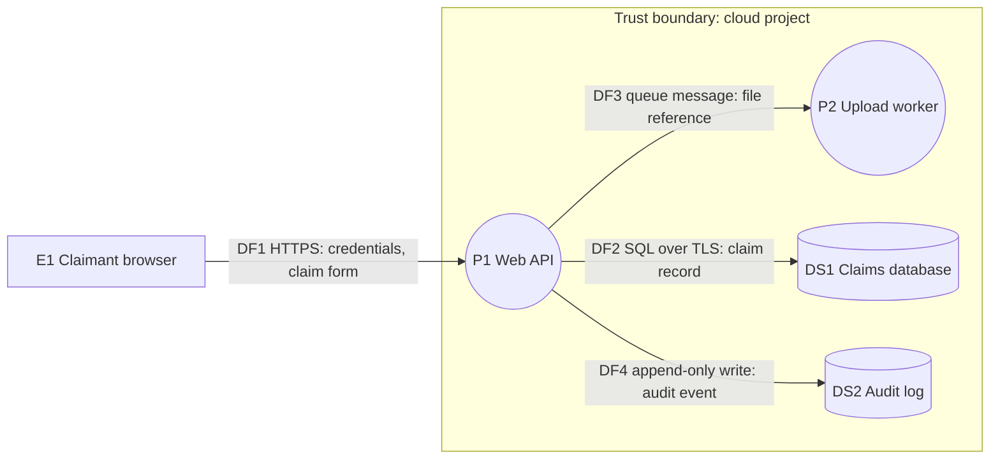

# STRIDE method for this skill

Contents:
- The six categories
- Which categories apply to which element
- Drawing the data flow diagram in Mermaid
- Rating likelihood, impact and risk
- From threat to 800-53 control
- Prompts for a government product

## The six categories

| Letter | Threat | Property it attacks |
| --- | --- | --- |
| S | Spoofing | Authentication |
| T | Tampering | Integrity |
| R | Repudiation | Non-repudiation |
| I | Information disclosure | Confidentiality |
| D | Denial of service | Availability |
| E | Elevation of privilege | Authorization |

The categories overlap. A successful elevation of privilege often brings tampering with it.
Pick the category that names the attacker's first move and stay consistent in one document.

## Which categories apply to which element

Ask only the questions in this table. Over-asking produces threats nobody can tie to a fix.

| Element | S | T | R | I | D | E |
| --- | --- | --- | --- | --- | --- | --- |
| External entity (person or outside system) | X |  | X |  |  |  |
| Process | X | X | X | X | X | X |
| Data store |  | X |  | X | X |  |
| Data flow |  | X |  | X | X |  |

A data store that holds logs also gets repudiation (can an attacker alter or delete the record
of what they did?).

Trust boundaries get their own question: what crosses this line, who vouches for it, and what
checks happen on the far side? Most real threats sit on a flow that crosses a boundary.

## Drawing the data flow diagram in Mermaid

Use a `flowchart`. One node shape per element type, one `subgraph` per trust boundary, and a
label on every flow that names the protocol and the data.

````markdown

````

- `[E1 name]` external entity, `((P1 name))` process, `[(DS1 name)]` data store.
- Collapse components that share a technology and a trust boundary into one node. Model the
  major functions, then break out detail where the risk is.
- Every data store needs a reader and a writer in the diagram. Data does not move without a
  process.
- Show the outside world as external entities. An attacker can do anything on that side.

## Rating likelihood, impact and risk

This is the house rubric of this skill. If the program has its own risk scale, for example one
set by the agency's risk management strategy or the five-level scale in NIST SP 800-30 Rev. 1,
use that scale and say so in the document.

| Level | Likelihood | Impact |
| --- | --- | --- |
| High | Reachable without special access, uses a well-known technique, or the weakness is visible in the code or configuration you read | Control of the system or its secrets is lost, sensitive records are exposed or altered at scale, or the mission function stops |
| Medium | Needs an authenticated user, specific knowledge, or a condition that is plausible but not always present | Limited exposure or alteration, harm to one user or tenant, or degraded service |
| Low | Needs insider access, physical access, or several unlikely conditions together | Minor, recoverable, or already contained by another control |

Risk from the two ratings:

| Likelihood \ Impact | High | Medium | Low |
| --- | --- | --- | --- |
| High | Critical | High | Medium |
| Medium | High | Medium | Low |
| Low | Medium | Low | Low |

Write the evidence next to each rating. Mark a rating `assumed` when it rests on a guess about
deployment or use.

## From threat to 800-53 control

Start from the table, then keep only the controls that fit the mitigation you wrote. Look up
each ID with `nist_catalog.py show`.

| Threat | Controls to consider |
| --- | --- |
| Spoofing | IA-2, IA-5, IA-8, SC-23, SC-17 |
| Tampering | SI-7, SI-10, SC-8, SC-13, AC-3 |
| Repudiation | AU-2, AU-3, AU-9, AU-10, AU-12 |
| Information disclosure | SC-8, SC-28, SC-12, SC-13, AC-3, AC-4, SI-11 |
| Denial of service | SC-5, SC-6, CP-9 |
| Elevation of privilege | AC-3, AC-6, SI-10, SA-11 |

Cite a control by ID and title in the register, for example `SC-8 Transmission Confidentiality
and Integrity`. Cite an enhancement as `SC-7(5)` only after looking it up.

## Prompts for a government product

Raise each as a question in the document when the sources do not answer it.

- **Data categories.** Does the system handle personal information or controlled unclassified
  information? The agency or contract decides the category. Record what the sources say.
- **Cryptography.** Which cryptographic modules protect data in transit, at rest and for
  signing, and is a validated module required by the authorization boundary? This ties to SC-13
  and IA-7. The skill reports the question and the evidence, and a person decides.
- **Audit.** Which events are recorded (sign-in, denial, privilege change, export, admin
  action), with what fields, where are they protected, and for how long are they kept? This ties
  to AU-2, AU-3, AU-9, AU-11 and AU-12.
- **Identity.** Who can sign in, with what strength of authentication, and how is a session
  ended? This ties to IA-2, AC-7 and AC-12.
- **Boundary.** What does the system call out to, and what can call in? This ties to SC-7 and
  AC-4.
- **Supply chain.** What third-party code, images and services does it depend on, and how is
  each one's origin established? This ties to SR-3, SR-4 and SR-11.
- **Language models.** If the system calls a model or runs tools from model output, treat model
  output and retrieved documents as untrusted input on the far side of a boundary, and ask what
  the model can reach with the privileges it holds.

## Sources

- Hernan, Lambert, Ostwald and Shostack, "Uncover Security Design Flaws Using the STRIDE
  Approach", MSDN Magazine, November 2006: the six categories, the data flow diagram elements and
  the per-element table.
  https://learn.microsoft.com/en-us/archive/msdn-magazine/2006/november/uncover-security-design-flaws-using-the-stride-approach
- Microsoft Threat Modeling Tool, STRIDE category definitions:
  https://learn.microsoft.com/en-us/azure/security/develop/threat-modeling-tool-threats
- NIST SP 800-53 Rev. 5, control titles and IDs (fetched through `nist_catalog.py`):
  https://csrc.nist.gov/pubs/sp/800/53/r5/upd1/final
- NIST SP 800-30 Rev. 1, Guide for Conducting Risk Assessments:
  https://csrc.nist.gov/pubs/sp/800/30/r1/final
