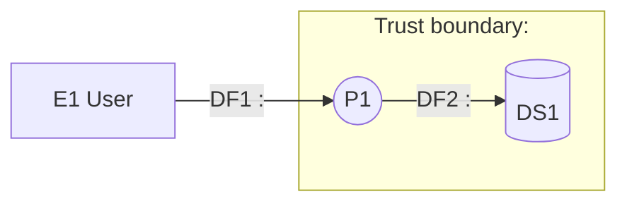

# Threat model document template

Copy the skeleton below into `docs/security/threat-model-<slug>.md` and fill it in. Keep the
heading words: `security_doc_check.py --kind threat-model` looks for them. Delete the guidance
in angle brackets. Control IDs below are examples of the format; replace them with the ones that
fit, and look each up with `nist_catalog.py show`.

````markdown
# Threat model: <system or feature>

- Status: draft for team review
- Date: <YYYY-MM-DD>
- Author: <name>
- Scope: <one paragraph: what is in, what is out, and the decision this model supports>
- Sources read: <list of the files and docs the model is based on>

## Summary

<Three to five lines: the highest risks, what they depend on, the first mitigations to build.>

## Assets

| ID | Asset | Why it matters | Classification or sensitivity (as stated by sources) |
| --- | --- | --- | --- |
| A1 | <claim documents> | <what loss or exposure causes> | <as stated, or "not stated; see open questions"> |

## Data flow diagram



| Element | Type | Description | File or config that shows it |
| --- | --- | --- | --- |
| P1 | Process | <what it does> | `<path:line>` |

## Trust boundaries

| Boundary | Between | What crosses it | Who vouches for it |
| --- | --- | --- | --- |
| tb1 | <outside> and <inside> | <data and requests> | <authentication or gateway> |

## Abuse cases

### AB-1: <attacker goal>
- Attacker: <who, with what access>
- Steps: <numbered steps through the diagram, naming elements>
- Needs: <preconditions>
- Gains: <impact>
- Threats: <T-IDs from the register>

## Threat register

Ordered from highest risk to lowest.

| ID | STRIDE | Element or flow | Scenario | Likelihood | Impact | Risk | Evidence | Mitigation | Controls | Status |
| --- | --- | --- | --- | --- | --- | --- | --- | --- | --- | --- |
| T-1 | S | DF1 | <who does what to gain what> | High | High | Critical | `<path:line>` or assumed | <what to build> | IA-2, SC-23 | open |
| T-2 | T, I | DF2 | <scenario> | Medium | High | High | assumed | <what to build> | SC-8, SC-13 | open |
| T-3 | R | P1 | <scenario> | Low | Medium | Low | `<path:line>` | <what to build> | AU-2, AU-12 | open |

## Mitigation plan

| Order | Mitigation | Closes | Controls | Owner | Notes |
| --- | --- | --- | --- | --- | --- |
| 1 | <change to build> | T-1 | IA-2 | <team or "unassigned"> | <effort, dependency> |

## Assumptions and out of scope

- <Assumption: what you took as true and could not confirm.>
- <Out of scope: what this model does not cover, and where it is covered.>

## Open questions

- <Question whose answer would change a rating, and who can answer it.>

## References

- NIST SP 800-53 Rev. 5 catalog version used: <from `nist_catalog.py fetch` output>
- <design docs, tickets, other models>
````
